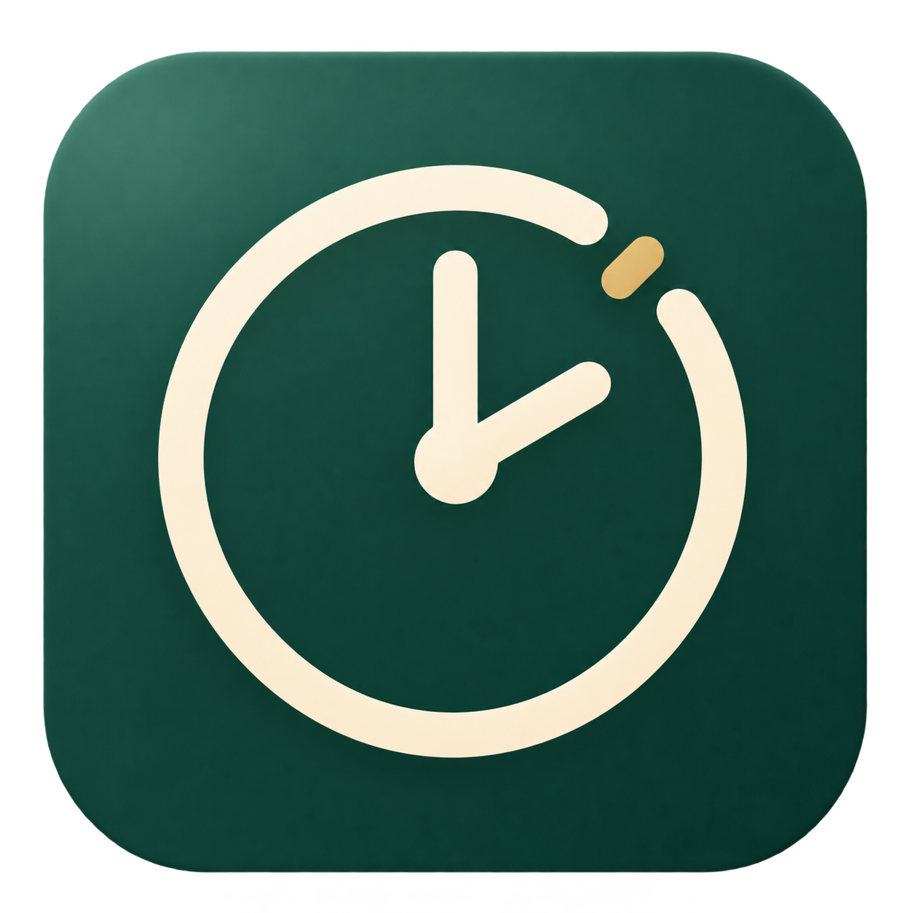

# ATime



**一个安静的桌面小窗，看看今天的时间去了哪里。**

ATime 是面向 Windows 的本地屏幕时间工具：统计有效使用时长和各软件的前台用时，在桌面实时展示，并将历史记录保存在自己的电脑上。

程序将同一图标内嵌到 EXE、窗口和系统托盘，小窗与统计页也使用统一标识。

**v0.1.1 新增「一天的节奏」**：今日按小时绘制真实使用时长，深色突出当前小时；近 7 日 / 近 30 日显示每日趋势。图表跟随有效使用 / 屏幕会话口径切换，悬停可查看精确时长，已有历史记录也可生成图表。

[](https://github.com/Vivianlee77/ATime/actions/workflows/ci.yml)
[](https://github.com/Vivianlee77/ATime/releases/latest)

**[下载 Windows 运行包](https://github.com/Vivianlee77/ATime/releases/download/v0.1.1/ATime-v0.1.1-win-x64.zip)** · [v0.1.1 发布说明](https://github.com/Vivianlee77/ATime/releases/tag/v0.1.1) · [详细使用说明](docs/08-running-mvp.md) · [反馈问题](https://github.com/Vivianlee77/ATime/issues)

## 下载与运行

当前版本：**v0.1.1（核心 MVP）**。面向 **Windows 11 x64**；Windows 10、ARM64 和远程桌面会话尚未完成支持验证。

1. 下载 **`ATime-v0.1.1-win-x64.zip`**。GitHub 自动提供的 `Source code` 是源码，不是运行包。
2. 将 ZIP 完整解压到可写目录，进入 `ATime-win-x64` 文件夹。
3. 双击 **`ATime.exe`**，桌面小窗和系统托盘图标出现后即可开始统计。

运行包已包含 .NET 运行环境，无需安装 SDK，无需管理员权限。请保留整个解压目录中的 DLL 和运行库。首次启动从零开始记录，无法补算安装前或程序退出期间的用时。

本版本尚未进行代码签名，Windows 可能显示未知发布者提示。请从本仓库 Release 下载；同一页面提供 `.sha256` 校验文件。

从 v0.1.0 升级：先从托盘退出旧版，再完整解压并运行新版。已有历史记录和设置自动沿用，无需清空数据库；桌面快捷方式可指向新版 `ATime.exe`，添加 `--dashboard` 参数可直接打开图表统计页。

## 能做什么

| 功能 | v0.1.1 行为 |
| --- | --- |
| 有效使用时长 | 连续 5 分钟无键鼠输入后暂停累计，恢复输入后继续；阈值可选 1 / 3 / 5 / 10 / 15 分钟 |
| 各软件使用时长 | 按前台应用归属，多个窗口和后台软件不会重复累计 |
| 桌面小窗 | 今日时分秒、前三应用、拖动、置顶、暂停与详情入口 |
| 统计详情 | 今日、近 7 日、近 30 日应用排行、时长和占比 |
| 节奏与趋势图 | 今日每小时用时、近 7/30 日每日趋势，突出当前时段，悬停查看时长 |
| 两种统计口径 | 有效使用时长与屏幕会话时长，可按阅读、视频等场景切换查看 |
| 本地保存 | SQLite 保存历史和设置，支持 CSV 导出、清空历史 |
| 托盘常驻 | 隐藏与恢复窗口、暂停与恢复记录、退出程序 |

## 怎样计算时间

**有效使用时长**是默认口径。空闲阈值以内的时间仍计入：例如 10:00 最后一次操作，10:05 达到默认阈值后停止累计，10:00–10:05 保留；10:10 恢复输入后重新计时，暂停的 5 分钟不会补算。

**屏幕会话时长**在本地会话已连接、解锁且显示未关闭时累计，不受键鼠空闲阈值限制，可参考长时间阅读或观看视频的情况。两种指标都不能判断人的实际注意力。

锁屏、显示关闭、休眠、会话断开、主动暂停和不可信采样缺口均不计入。只统计当前前台应用，桌面与无法识别的应用单独归类。应用归属采用系统事件及周期采样，极短的连续切换可能合并。

## 日常操作

- **移动与置顶**：拖动小窗标题移动位置；点击“置顶”切换。
- **查看详情**：点击小窗的“查看详情”，或从托盘右键菜单打开。
- **查看节奏图**：统计卡片下方显示「一天的节奏」。每根柱对应一个小时，零记录显示为空；鼠标移到柱上查看该小时的精确时长。切换日期范围后展示每日趋势。
- **切换口径**：右键小窗标题选择；详情页使用下拉框。两个窗口各自保存显示选择，查看时留意指标名称。
- **暂停与恢复**：小窗、详情页和托盘均可操作。主动暂停会跨重启保留。
- **隐藏与退出**：窗口的“×”只隐藏，后台继续按当前状态记录。单击托盘图标找回小窗；右键托盘选择“退出 ATime”才会停止程序。
- **导出**：在详情页导出所选日期范围的 CSV。清空历史需要确认，会保留设置，不会删除已导出的文件。

## 数据与隐私

新用户的数据与设置位于 `%LOCALAPPDATA%\ATime\usage.db`。数据是当前用户目录中的本地明文；程序无账号、云同步、遥测或后台网络请求。

ATime 记录应用名称、时间区间和用时汇总，应用身份使用路径哈希。**不记录窗口标题、按键内容、网址、剪贴板或截图**，不默认保存完整可执行路径。CSV 只在主动导出时生成。

从原 `ScreenTimeCompanion` 版本升级时：若新目录尚无数据库且 `%LOCALAPPDATA%\ScreenTimeCompanion\usage.db` 已存在，ATime 会直接沿用旧目录，保留历史及设置，不自动搬动或合并数据库。请先从托盘退出旧版，再运行 ATime。备份时也应先退出程序，再复制实际数据目录。

## 从源码构建

开发环境：Windows x64、PowerShell、Git，以及 [global.json](global.json) 指定的 **.NET SDK 10.0.404**。项目使用 C#、WPF 和 Microsoft.Data.Sqlite。

```powershell
git clone https://github.com/Vivianlee77/ATime.git
cd ATime
./scripts/build.ps1 -Publish
```

脚本完成依赖还原、Release 编译、自动化测试、输入时间转换检查和 Windows 自包含打包，输出：

```text
artifacts/
├─ ATime-win-x64/                  # 可运行目录，入口 ATime.exe
├─ ATime-v0.1.1-win-x64.zip         # 完整运行包
└─ ATime-v0.1.1-win-x64.zip.sha256  # SHA-256 校验值
```

仅构建与测试可执行 `./scripts/build.ps1`。提交和 Pull Request 会触发 [GitHub Actions](https://github.com/Vivianlee77/ATime/actions)，成功后提供构建产物；稳定版本从 Release 下载。

校验下载文件（将 ZIP 与 `.sha256` 放在同一目录）：

```powershell
$actual = (Get-FileHash .\ATime-v0.1.1-win-x64.zip -Algorithm SHA256).Hash
$expected = ((Get-Content .\ATime-v0.1.1-win-x64.zip.sha256 -Raw).Trim() -split '\s+')[0]
$actual -eq $expected  # True 表示校验一致
```

## 项目结构

```text
ATime.slnx
src/
├─ ATime.Core/       # 计时状态机、前台归属、跨日处理
├─ ATime.Windows/    # Win32 前台、输入、会话与电源状态采集
├─ ATime.Storage/    # SQLite 持久化、汇总与设置
└─ ATime.App/        # WPF 小窗、统计详情、托盘与协调服务
tests/              # 计时与存储回归测试
docs/               # 产品、架构、使用与验证文档
prototype/          # 使用示例数据的 HTML 设计原型
scripts/            # 构建和打包脚本
```

## 当前边界与后续计划

v0.1.1 已实现有效时长、各软件统计、桌面小窗、小时节奏和每日趋势图。登录自启、隐私应用排除规则、深色主题、安装器和自动更新尚未实现。

本地自动化覆盖计时、跨日与时钟调整、SQLite 一致性、旧版数据目录兼容及输入 tick 转换。真实 Windows 采集与暂停、恢复、重启、导出、清除流程有验证记录；尚未完成主动锁屏与休眠的硬件矩阵、混合 DPI 多屏和 24 小时稳定性验收。详见 [验证记录](docs/09-mvp-validation.md)。

遇到问题可提交 [Issue](https://github.com/Vivianlee77/ATime/issues)，附上 Windows 版本、ATime 版本、复现步骤与错误提示。无需上传个人使用数据库。

## 文档

| 文档 | 内容 |
| --- | --- |
| [产品需求](docs/01-product-requirements.md) | 完整目标范围与统计口径 |
| [界面交互](docs/02-ui-design.md) | 小窗、托盘、详情和异常状态 |
| [技术架构](docs/03-technical-architecture.md) | 原生 API、分层与生命周期 |
| [计时与数据](docs/04-accounting-and-data.md) | 状态机、区间与对账规则 |
| [开发计划](docs/05-development-plan.md) | 后续完整版本路线图 |
| [测试计划](docs/06-testing-and-acceptance.md) | 完整版本验收目标 |
| [官方参考](docs/07-references.md) | 平台与 API 文档 |
| [使用说明](docs/08-running-mvp.md) | 当前版本操作与限制 |
| [验证记录](docs/09-mvp-validation.md) | 已执行检查与未覆盖项 |
| [交互原型](prototype/index.html) | 可在浏览器打开的设计演示 |

原始设计文档和交互原型包含未来功能，以本 README 和使用说明列出的当前能力为准。

## 作者与许可

作者：[Vivianlee77](https://github.com/Vivianlee77)。仓库公开可见；当前尚未指定开源许可证，公开源码不等同于授予任意使用、修改和再分发的许可。
