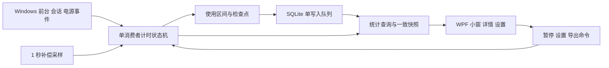

# 技术架构

版本：v0.1 设计基线；日期：2026-11-12。此文档定义待实现架构。

## 1. 技术选择

采用 **C# + .NET 10 LTS + WPF + Microsoft.Data.Sqlite**。运行于当前用户的普通桌面进程，通过 Win32 读取前台应用和会话状态，本地存储，不设置服务端。

WPF 提供 Windows 窗口、布局和数据绑定，并且仅运行在 Windows；与本项目单平台目标一致。[WPF 官方说明](https://learn.microsoft.com/en-us/dotnet/desktop/wpf/overview/)。.NET 10 是 LTS，具体 SDK 和依赖补丁在开始开发时锁定受支持的稳定版本。[.NET 支持政策](https://dotnet.microsoft.com/en-us/platform/support/policy/dotnet-core)。

| 方案 | 本项目判断 |
| --- | --- |
| C# / WPF | 首选。原生窗口、托盘、Windows 消息与采集逻辑在同一语言中实现，部署链路清楚 |
| WinUI 3 | 可实现；首版无需额外引入 Windows App SDK 和不同的窗口管理体系 |
| Tauri / Rust / Web UI | 适合已有前端与 Rust 团队；本项目仍需 Windows 原生采集和互操作层，暂不选择 |
| Python / PySide | 适合早期验证；正式常驻版还要处理运行环境、打包与原生互操作，本次优先 C# |
| Electron | 能实现界面；为此小型 Windows 工具额外引入完整 Web 运行栈的收益有限 |

比较是本项目的工程判断，不是各框架的实测性能排名。

### 支持范围

正式基线：仍处于支持期的 Windows 11 x64 桌面版本，普通账户可运行，目标框架 `net10.0-windows`。Windows 10、ARM64、Windows Server、RDP 不列入首版承诺。Windows 10 的部分专用版本仍出现在 .NET 支持表中，但不能据此承诺所有 Windows 10 都受支持。[官方系统支持列表](https://github.com/dotnet/core/blob/main/release-notes/10.0/supported-os.md)。

## 2. 系统结构



进程只有一个，但职责分层。UI 关闭或渲染变慢不能改变计时结果；定时器触发次数不是时长。第一版不做 Windows Service、驱动、跨进程守护服务或云同步。

| 模块 | 职责 | 不承担 |
| --- | --- | --- |
| Domain | 状态归约、区间切分、统计不变量；可注入时钟 | 调用 Windows、数据库或 UI |
| Windows | Win32 封装、消息窗口、前台/输入/电源/会话采样、身份解析 | 决定产品统计口径 |
| Application | 协调队列、命令、快照、恢复、导出 | 直接操作 WPF 控件 |
| Infrastructure | SQLite、迁移、配置、启动项、日志、实例锁 | 在 UI 线程执行数据库工作 |
| App | WPF MVVM、小窗、详情、托盘、设置 | 在 ViewModel 内自行累计时间 |

## 3. Windows 信号采集

| 信号 | API 或机制 | 实现约束 |
| --- | --- | --- |
| 前台窗口变化 | `SetWinEventHook(EVENT_SYSTEM_FOREGROUND, WINEVENT_OUTOFCONTEXT)` | 专用消息循环，回调保留强引用；只入队，不执行数据库/图标操作 |
| 前台校正 | 每 1 秒 `GetForegroundWindow` | 可返回空句柄；记“未识别”，不沿用旧应用 |
| 窗口所属应用 | `GetWindowThreadProcessId` → `OpenProcess(PROCESS_QUERY_LIMITED_INFORMATION)` → `QueryFullProcessImageNameW` | 关闭进程句柄；失败不得请求提权或使用旧 PID 缓存误认 |
| 打包应用 | 尝试 `GetApplicationUserModelId`，辅以经过验证的宿主识别 | ApplicationFrameHost 等必须真实验证，无法解析则归未知 |
| 最近输入 | `GetLastInputInfo` | 仅当前会话；处理 32 位 tick 回绕、非单调返回与异常值 |
| 会话 | `WTSRegisterSessionNotification` 与初始 WTS 状态查询 | 订阅当前会话；处理锁/解锁、控制台连接/断开、注销、远程连接 |
| 会话显示 | `RegisterPowerSettingNotification(GUID_SESSION_DISPLAY_STATUS)` | 0 关闭、1 开启、2 变暗；变暗仍允许计时；不是逐显示器功耗测量 |
| 休眠/恢复 | `WM_POWERBROADCAST` | 恢复后重新建立采样基线，不直接延长休眠前区间 |
| 时钟 | `Stopwatch` / QPC、UTC 和辅助 `QueryUnbiasedInterruptTime` | 时长使用单调时钟；辅助检测未提前通知的睡眠 |

API 细节与来源集中在 [参考资料](07-references.md)。不使用 `WINEVENT_SKIPOWNPROCESS`：操作本软件详情页时应归本软件，而不是继续归前一个应用。

### 初始状态与异常

启动顺序为注册通知、读取当前会话/锁定状态、建立显示状态、采样前台和输入、最后进入计时。显示通知初始值的到达行为列入技术验证；必要时等待首个可信通知，不能把未收到消息直接当作屏幕开启。

启动时不可确认的关键会话/显示状态标记 `Unknown` 并显示“等待系统状态”。成功采样后恢复；解锁也需要重新读取其他状态。显示状态来源失败时不宣称真实亮屏时间。

远程会话进入 `UnsupportedSession`，提示首版支持本地会话并停止累计；回到本地控制台后重新采样。同一个 Windows 用户的另一个会话不得同时写同一数据库。

## 4. 应用身份与隐私

普通 Win32 应用优先用规范化可执行路径形成稳定身份，展示名来自进程文件名或文件版本信息。路径只用于内存识别，默认数据库保存路径哈希和名称，不保存完整路径。哈希不等于匿名化承诺。不要用 PID、窗口标题、安装显示名作为唯一键。

打包应用优先以经过验证的 AUMID 为身份；同一应用不同版本的路径变动可能生成不同项目，首版允许分别显示，手动合并列入后续版本。Electron 的 renderer 进程、多个 VS Code 窗口应归同一前台主程序身份；浏览器内各网站仍统一归浏览器。

缓存键包含 PID 和进程创建时间；退出后失效，缓存有容量上限。路径/图标读取在后台做短时限操作，失败使用占位图标。身份解析未完成期间先记未知桶，首版不跨已经提交的区间猜测回填。

内置桶为 `system-desktop`、`self`、`unknown`、`private`。桌面识别使用可信窗口/进程规则，不用任意标题匹配。隐私规则命中后在进入计时记录、日志和 UI 快照前替换为 `private`；规则设置可保存用于匹配的标识和用户可读名，但具体使用区间不得关联原应用。

不采集按键内容、鼠标坐标、窗口标题、剪贴板、截图、网址、文件内容或浏览历史。`GetLastInputInfo` 只读取最近一次输入时间。

## 5. 线程与一致性

- 一个后台消息循环接收 Windows 事件；事件只携带必要信号和时间戳。
- 一个单消费者队列归约计时状态，所有用户命令也通过该队列排序。保留 `receivedMonotonicTime` 与源时间；乱序旧事件不能倒退已结算状态（包括尚未提交的段），使用重新采样校正并标记质量事件。
- 1 秒计时器只推动采样，不直接增加 1 秒。Windows 前台事件到达时立即按边界切分。
- 一个持久化工作队列持有写连接；读查询使用短生命周期连接与短事务。同步 SQLite I/O 在后台运行，不能因为方法名带 `Async` 就认为不会阻塞。[Microsoft.Data.Sqlite 异步限制](https://learn.microsoft.com/en-us/dotnet/standard/data/sqlite/async)。
- 小窗可见时每秒刷新快照；隐藏时不刷新画面；详情非实时历史查询按用户操作或提交版本刷新。
- 队列有界，容量与最大积压时长均受监测。信号积压超过 3 秒或关键事件丢失时，创建采集缺口并重建状态，不把长间隔全部归旧应用。

## 6. 逻辑接口约定

以下为设计接口，非已实现代码；命名在建仓时可调整，职责不能混合。

```csharp
interface IWindowsSignalSource { IAsyncEnumerable<TrackingSignal> ReadAll(CancellationToken ct); }
interface IClock { ClockSample Sample(); } // monotonic + UTC + unbiased time
interface IAppIdentityResolver { ValueTask<AppIdentity> ResolveAsync(WindowIdentity window); }
interface IUsageEngine { EngineOutput Apply(TrackingSignal signal); }
interface IUsageStore { Task CommitAsync(UsageBatch batch, CancellationToken ct); }
interface IStatisticsService { Task<UsageSnapshot> QueryAsync(UsageQuery query, CancellationToken ct); }
interface ITrackingController { Task ExecuteAsync(TrackingCommand command, CancellationToken ct); }
```

`UsageQuery` 包含日期范围和口径 `Effective | Session`；`UsageSnapshot` 包含总时长、全量应用桶、小时/日分布、采集状态、质量标记、提交版本以及未提交差值。UI 不从另一条查询单独拼总数。

暂停/恢复/设置变更需等待状态机确认再更新 UI；持久化失败通过明确状态返回。CSV 导出使用一个一致的已提交快照，先请求提交当前缓冲；失败时提示导出截至最后成功保存的时间，由用户决定是否继续。

## 7. 小窗、托盘与进程生命周期

WPF 使用 `ShutdownMode=OnExplicitShutdown`，托盘采用 `System.Windows.Forms.NotifyIcon`；配置 `UseWPF`，为托盘启用对应 WinForms 支持，避免命名空间歧义。[WPF 生命周期](https://learn.microsoft.com/en-us/dotnet/api/system.windows.application.shutdownmode?view=windowsdesktop-10.0)、[NotifyIcon](https://learn.microsoft.com/en-us/dotnet/api/system.windows.forms.notifyicon?view=windowsdesktop-10.0)。

小窗 `ShowInTaskbar=false`，显示/刷新不主动激活，用户点击控件时可正常获得焦点。默认开启可切换的置顶；关闭小窗/详情窗口只隐藏。托盘含显示小窗、打开统计、暂停/恢复、设置和退出。首次关闭时说明仍在托盘记录。

使用公开窗口机制，不依赖 Explorer 的 WorkerW 桌面嵌入。置顶不保证盖过安全桌面或独占全屏程序，v0.1 不做自动全屏避让。位置按显示器工作区和 DIP 保存；启动、DPI 改变、显示器断开时重新钳制到可见工作区。

每用户数据目录用 OS 持有的排他文件锁阻止多进程；进程终止由 OS 释放锁，不用“文件存在”判断存活。同会话第二次启动通过限制当前用户访问的命名管道激活已有窗口；不同会话检测到锁则提示已有实例，不夺取或写数据库。管道仅允许白名单激活命令。

开机启动默认关闭。普通用户安装采用当前用户启动项，设置中开启后检查注册结果，关闭/卸载移除；注册表内容必须正确引用带空格路径。仅声明“登录后启动”，不承诺 Windows 会立即启动。安装方式定型后，在 Run 项与打包启动任务中只选一种，避免重复启动。

退出时停止新事件、切分尾段、提交、注销钩子和通知、释放托盘与数据库资源。存储失败时明确提示未保存；系统关机不给足时间时不能无限阻止关机。

## 8. 本地数据与错误策略

建议目录 `%LOCALAPPDATA%\ATime\`，含 `usage.db`、图标缓存和日志。数据库为当前账户可访问的本地明文文件，继承用户目录权限；不声称数据库已加密。首版无遥测和后台网络调用，日志滚动上限 10 MB、保留 7 天，不含应用切换流水或完整路径。

`Microsoft.Data.Sqlite` 作为轻量 ADO.NET 数据访问层，不额外引入 ORM。[官方介绍](https://learn.microsoft.com/en-us/dotnet/standard/data/sqlite/)。迁移、事务、恢复见文档 04。依赖锁文件同时确认实际装载的 SQLite 原生库修订版本，满足官方 WAL 修复要求。[SQLite WAL 修复说明](https://sqlite.org/wal.html#the_wal_reset_bug)。

| 故障 | 行为 |
| --- | --- |
| 单个应用无权限读取 | 未识别桶；总时长仍可累计 |
| 关键状态无法确认 | 统计受限/等待系统状态；不累计不可靠区间 |
| 写入失败/磁盘满 | 停止接受新计时，显示存储错误，保留已有缓冲最多 30 秒；恢复后提交仍保有的精确区间，其余记缺口 |
| 数据库迁移失败 | 不覆盖旧库；保留迁移前备份，提供明确错误与数据位置 |
| 崩溃重启 | 截止最后已提交终点，不补算程序停止期间 |
| 图标读取失败 | 占位图标，计时继续 |

检测到存储失败后不得让界面仍以“记录中”持续涨数；错误状态和最后保存时间应同时可见。
