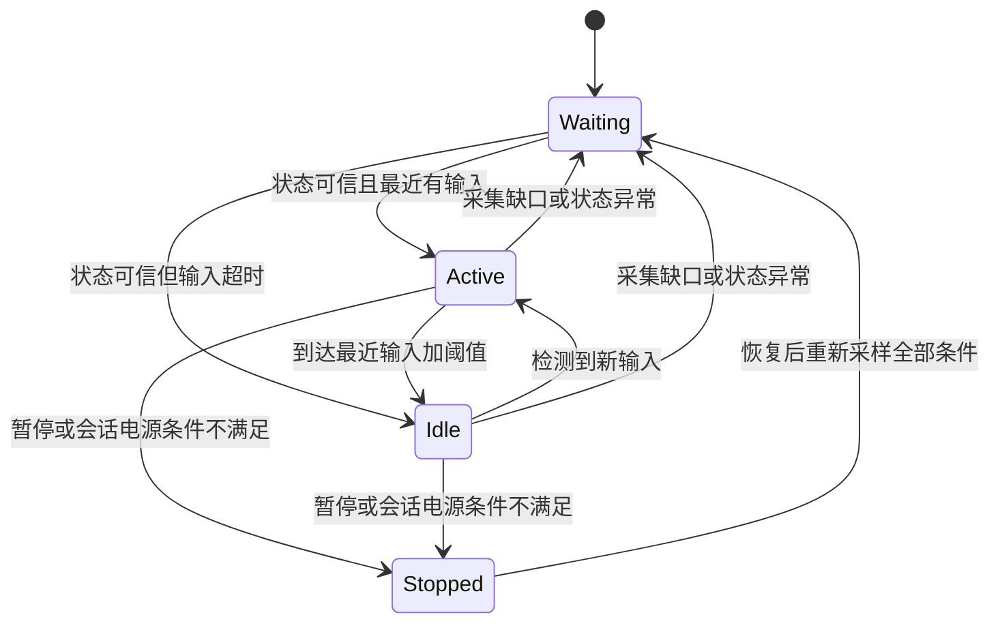

# 计时算法与数据设计

版本：v0.1；日期：2026-11-12。本文件是计时实现和测试的规范。毫秒为内部精度，显示时才格式化。

## 1. 两个指标与不变量

设 `eligible` 为：程序正在记录、存储健康、当前本地会话连接且未锁定、未休眠、会话显示开启或变暗、系统状态可信。

```text
屏幕会话时长 S = eligible 区间的持续时长之和
有效使用时长 E = eligible 且距最近输入不足空闲阈值的区间时长之和
默认空闲阈值 T = 300 秒

0 ≤ E ≤ S
E = Σ 全部应用桶的有效使用时长
S = Σ 全部应用桶的屏幕会话时长
```

两种数据同时计算，切换视图不重算采集历史。进入空闲后 `E` 停止、`S` 继续；锁屏、显示关闭、暂停或退出后两者均停止。该工具只能记录安装并开始运行之后的时间。

前台唯一归属：一个可计时区间只能属于一个应用桶，包括本软件、系统桌面、未知和隐私桶。后台进程不分配时长，分屏和多显示器不重复计算。详情筛选单个应用只改变筛选结果，不把筛选后合计冒充全局总计。

阈值是输入后的宽限期。例如 10:00 最后输入，10:05 进入空闲，10:00–10:05 仍计有效；10:20 再输入后重新计时。不会在 10:05 回扣已显示的 5 分钟。切换应用的系统事件不等于用户输入，不能自动刷新最近输入时间。

## 2. 状态模型

用多维事实计算状态，不用一个开关代替所有条件。保存：用户暂停、存储健康、会话类型/连接/锁定、系统挂起、显示状态、最近输入、前台身份、采样可信度。

| 结果状态 | 条件 | 有效 E | 会话 S | 归属 |
| --- | --- | --- | --- | --- |
| Active | eligible 且输入未超时 | 增长 | 增长 | 当前应用/内置桶 |
| Idle | eligible 且输入已超时 | 不增长 | 增长 | 当前前台应用/内置桶 |
| Paused | 用户主动暂停 | 不增长 | 不增长 | 不创建使用区间 |
| Locked / Disconnected | 当前会话锁定或断开 | 不增长 | 不增长 | 不创建使用区间 |
| DisplayOff / Suspended | 会话显示关闭或系统挂起 | 不增长 | 不增长 | 不创建使用区间 |
| UnsupportedSession | 远程等首版不支持会话 | 不增长 | 不增长 | 不创建使用区间 |
| Uncertain / StorageError | 关键状态未知、事件积压或存储失败 | 不增长 | 不增长 | 质量事件/缺口 |

多条件同时存在时，计时是否允许由全部条件共同决定。UI 显示优先级为存储错误、用户暂停、会话不支持/断开、锁定、挂起/显示关闭、状态未知、空闲、记录中。解锁不会清除用户暂停；恢复供电不会覆盖仍然存在的锁定状态。



图中的 `Stopped` 是不计时状态集合，未表示程序一定退出。

## 3. 时间来源与区间边界

### 3.1 单调时钟

使用 `Stopwatch` 的单调时间戳计算时长，使用 UTC 标记日期。采样内容同时含 `UtcNow`、单调时钟和 `QueryUnbiasedInterruptTime`；后者不包含睡眠/休眠，用来帮助识别失去电源通知的长中断。[QPC 与 Stopwatch](https://learn.microsoft.com/en-us/windows/win32/sysinfo/acquiring-high-resolution-time-stamps)、[无偏中断时间](https://learn.microsoft.com/en-us/windows/win32/api/realtimeapiset/nf-realtimeapiset-queryunbiasedinterrupttime)。

不允许 `duration += 1`、用 UI Timer 次数计时、以 `DateTime.Now` 相减计持续时间，或恢复后把整个休眠间隔加给旧应用。

### 3.2 输入时间

`GetLastInputInfo.dwTime` 是 32 位系统 tick，不能与 UTC 直接相减。与当前系统 tick 的低 32 位做无符号差值，处理约 49.7 天回绕；建立与当前单调时钟的映射。值异常、疑似逆序或无法分辨多次回绕时，不生成负空闲时长或巨大有效区间，而是请求下一次采样并显示状态受限。[API 限制](https://learn.microsoft.com/en-us/windows/win32/api/winuser/nf-winuser-getlastinputinfo)。

常规采样每秒一次；阈值边界 `lastInput + T` 若落在两个样本之间，需精确切分。空闲状态发现新输入时，可将恢复边界定位到最近输入 tick，但只能切分尚未结算的区间。维护不可回退的 `last_settled_mono` 水位；早于该水位的输入/系统事件不回填已结算区间，即使该区间尚未提交。记录延迟并重新采样，避免引入历史撤销逻辑。正常单次采样内的恢复误差受采样间隔限制，队列积压另记缺口。不记录输入内容。

### 3.3 必须切分的时刻

前台应用变化；空闲/活跃变化；锁定/解锁；连接状态变化；显示开启/关闭；挂起/恢复；暂停/恢复；隐私规则或阈值变更；本地日期或 UTC 偏移变化；时间锚点重建；单段达到 60 秒。

所有区间为左闭右开 `[start, end)`。同一运行中的单调时间区间不得重叠；边界事件发生在 `end` 的输入只影响下一区间。重复通知要幂等处理，不能创建零长度永久记录。

### 3.4 缺口

正常采样目标为 1 秒。相邻可靠样本超过 3 秒且缺少可验证的完整中间事件时，将**整个不可确认间隔**标记缺口，不能只截断到 3 秒再计给旧应用。下一次可靠采样从新边界开始。休眠事件丢失、消息线程阻塞和队列溢出均适用。

缺口不是“未知应用”：未知应用表示知道会话满足统计条件但不知道应用身份，仍可按当前输入状态计时；缺口表示无法确认是否符合统计条件，不计入任何用时。两者都不能据此推断用户正在注视屏幕。

异常退出后只知道最后保存时间和再次启动时间，不能断言中间全部是采集故障或电脑开着。显示“记录不连续”，区分 `NotRunningOrCrash` 与可测量的 `SamplingGap`。

## 4. 状态机处理顺序

```text
receive(signal):
  1. 校验源时间与接收时间，过期/重复信号不倒退状态
  2. 检查上一可靠样本到本次的连续性、时钟锚点和系统恢复情况
  3. 若可信：按已知状态给上一段分配时长
     在输入阈值、日期/偏移、60秒上限等内部边界切分
     任何新输入的已知发生时间先参与上述切分
     若不可信：结束于上一可靠边界，记录缺口，不推测旧应用
  4. 应用本次信号，重新推导所有 eligible 条件和前台归属
  5. 生成当前不可变快照，发布给 UI
  6. 边界变化请求提交；最迟每 5 秒提交当前段的已观察终点
```

系统事件以事件自身的可靠发生时间为边界；无法可靠换算时按接收时间处理并保留质量标记。晚到边界早于 `last_settled_mono` 时不改写此前用时，强制重采样，避免重复或倒流。该结算水位独立于数据库提交水位；所有信号使用同一规则。API 调用、数据库等待和图标解析不在状态机内阻塞执行。

隐私规则启用时先关闭旧段，再将之后的归属改为 `private`；不得把整段之前的时间一并改隐私。阈值改动也仅影响设置变更时刻之后：例如已空闲 4 分钟时把阈值从 5 改为 2，立即结束有效计时但不回扣前 4 分钟。

## 5. 日期、时区与时间修改

首次启动把系统 Windows 时区 ID 保存为 `reporting_timezone`；MVP 固定使用该统计时区，不跟随旅行时区自动重分组，也不提供任意改时区重算。设置可显示当前统计时区，说明与系统时区不一致的情况；后续版本再做显式迁移。

UTC 用 Unix 毫秒存储；区间同时记录统计日期 `YYYY-MM-DD`、时区 ID、该段 UTC 偏移。按固定时区的午夜和夏令时偏移边界切分，不能假定一天永远 86,400 秒。夏令时回退产生的重复小时以 UTC 起点/偏移区分，日图可标记重复小时。

例：23:58–00:03 持续有效使用 5 分钟，前一天 120 秒、后一天 180 秒，应用及总计一起切分。

比较真实 UTC 与“UTC 锚点 + 单调经过时间”。偏差大于 2 秒或收到明确时钟修改信号时建立新的 `clock_epoch`。已确认的旧段按旧锚点封口，之后按新锚点记日期；不把调整的 1 小时当使用时长。时钟回拨可能使两个 epoch 的 UTC 标签重叠，但单调区间和总持续时间不得重叠或重复。UI/导出保留 `clock_adjusted` 标记，不能用 `endUtc - startUtc` 跨 epoch 重新计算总计。

## 6. 数据模型

### 6.1 设计表

| 表 | 主要字段与约束 | 用途 |
| --- | --- | --- |
| `apps` | `app_id PK`，`identity_kind`，`identity_hash UNIQUE`，`display_name`，`exe_name`，`icon_cache_key`，`is_builtin` | 稳定应用身份和展示信息；不存完整路径/标题 |
| `tracking_runs` | `run_id PK`，`started_utc_ms`，`last_commit_utc_ms`，`ended_utc_ms NULL`，`exit_kind` | 识别一次运行、正常结束与恢复 |
| `clock_epochs` | `epoch_id PK`，`run_id FK`，`anchor_mono_ms`，`anchor_utc_ms`，`reason` | 单调时间到 UTC 的分段映射 |
| `usage_segments` | 下表 | 已确认的计时事实 |
| `daily_app_usage` | `local_date, timezone_id, app_id` 联合 PK；`effective_ms`，`session_ms` | 当日应用汇总缓存，可从区间重建 |
| `coverage_events` | `event_id PK`，`run_id`，`start_utc_ms`，`end_utc_ms NULL`，`kind`，`known_duration_ms NULL` | 暂停、已知缺口、存储失败、时钟调整等，不含窗口内容 |
| `app_rules` | `rule_id PK`，`identity_hash`，`display_name`，`action=private`，`enabled`，`updated_utc_ms` | 未来应用隐私规则；不和隐私区间建立关联 |
| `settings` | `key PK`，`value_json`，`updated_utc_ms` | 阈值、口径、小窗坐标、时区、暂停状态等 |
| `store_state` | 单行 `id=1 PK`，`commit_seq`，`data_generation` | 每个成功写事务递增提交序号；清空数据增加generation，使旧查询失效 |
| `schema_migrations` | `version PK`，`applied_utc_ms` | 顺序迁移版本 |

`usage_segments` 字段：

| 字段 | 类型与规则 |
| --- | --- |
| `segment_id` | TEXT，UUID 主键，检查点更新始终复用 |
| `run_id`, `epoch_id` | TEXT，外键 |
| `sequence_no` | INTEGER，同一 run 唯一、递增 |
| `app_id` | TEXT，非空外键；必须能归入内置桶 |
| `activity_kind` | TEXT，仅 `active` 或 `idle` |
| `start_mono_ms`, `end_mono_ms` | INTEGER，相对本次 run 的单调毫秒；end > start |
| `start_utc_ms`, `end_utc_ms` | INTEGER，在同一 epoch 内映射，不跨 epoch |
| `duration_ms` | INTEGER，`end_mono_ms - start_mono_ms`，范围 1–60000 |
| `local_date`, `timezone_id`, `utc_offset_minutes` | TEXT/TEXT/INTEGER，单段不跨统计日或偏移边界 |
| `settings_revision` | INTEGER，记录生效设置版本，便于解释阈值变化 |
| `revision` | INTEGER，任意持久化字段变化均递增，包含相同终点的封口；重试沿用原版本 |
| `sealed` | INTEGER 0/1；0 仅表示当时仍在进行，不授权重启后续算 |
| `end_reason` | TEXT，可空：switch、idle、lock、display_off、pause、minute、midnight、clock_change、exit 等 |

约束包括外键、非负汇总、`effective_ms <= session_ms`、`UNIQUE(run_id, sequence_no)`。`sealed` 仅允许0→1；封口后禁止延长。索引建议 `(local_date, app_id)` 与 `(local_date, start_utc_ms)`；先通过实际查询计划验证，避免给每列建索引。

### 6.2 聚合定义

```sql
-- 设计查询示意：输入参数由应用绑定，不能拼接 SQL。
SELECT local_date, app_id,
       SUM(duration_ms) AS session_ms,
       SUM(CASE WHEN activity_kind = 'active' THEN duration_ms ELSE 0 END) AS effective_ms
FROM usage_segments
WHERE local_date >= $from AND local_date <= $to
GROUP BY local_date, app_id;
```

小时分布将区间按统计时区的小时边界取交集后累加，不能把跨整点段全部算给开始小时。过去 7/30 日为包含今天的连续日历日，不是滚动 168/720 小时。没有记录的日期显示“无记录”；已确认记录中但有效值为零时显示“0 分钟”，不能用同一种空白代替。

## 7. 持久化与实时展示

### 检查点

同一状态连续时保留一个稳定 `segment_id`，每 5 秒提交它的最新终点；达到 60 秒或状态边界后封口并新建下一段。不为每秒快照永久插入一行。

一个事务中执行：读取旧 revision/贡献；仅当新 revision 更大时 upsert 段；将新贡献减旧贡献的差值更新日汇总；更新 run 的提交水位；递增并取得 `store_state.commit_seq`；提交事务。提交序号不可使用UTC时间代替，避免时钟回拨破坏排序。重复 batch、重复通知或恢复重试不得再次加总。零长度临时段仅在内存存在。

切换应用、锁屏、暂停、正常退出均请求尽快提交；5 秒是正常工作条件下的最大检查点间隔目标。写入较慢时显示未保存状态和最后提交时间，不无条件保证 5 秒崩溃损失。

### 快照

实时值 = 同一提交版本的数据库值 + 当前内存里尚未被该版本包含的差值。具体交接规则：

1. 查询在同一读事务中取得 `data_generation`、`commit_seq` 和统计结果。
2. 状态机保留所有尚未进入已发布基准快照的贡献，包括已封口的段；写入确认只标记这些贡献被哪个commit覆盖，不立即丢弃。
3. 快照协调器按 segment ID/revision 计算相对该读事务基准的差值，连同基准原子发布；旧查询结果不得覆盖较新版本。
4. 新基准已发布且无旧版本查询仍需相关贡献时才能释放其内存；使用单个协调器串行处理查询/提交确认，避免双算或短暂少算。
5. 清空历史增加generation，取消/丢弃旧generation的查询结果和缓冲，不能重新显示被清除的数据。

提交确认不意味着 UI 已切到新基准；不能先清内存差值，再让仍读旧版数据库的查询发布结果。

### SQLite 配置

启用 `foreign_keys=ON`、WAL、`synchronous=FULL`，设置合理 busy timeout（起点 3 秒）；读事务短暂持有，写/检查点由单写队列协调。数据置于本地用户目录，不放网络盘或云同步目录。备份调用在线备份 API，不单独复制正在写的 `.db`。[WAL](https://sqlite.org/wal.html)、[在线备份](https://www.sqlite.org/backup.html)。

发布时校验实际原生 `sqlite_version()` 使用受维护稳定版本，至少包含 3.51.3 的 WAL-reset 修复，或官方明确带该修复的回移版本；首选不低于 3.51.3 的新版本。[官方修复说明](https://sqlite.org/wal.html#the_wal_reset_bug)。

### 崩溃与保留

未正常结束的 run 标记异常结束，旧段只保留最后已提交终点。新运行使用新 run/epoch，绝不把旧段补到重启时刻。正常存储和采样条件下，进程强杀丢失目标不超过 5 秒；机器断电、磁盘错误不承诺同一上限。

MVP 默认保留全部历史，不做自动清理；设置显示数据库大小并提供清除功能。按单段上限 60 秒、每天 8 小时无额外切换估算，至少约 480 段/日；真实数量随切换和状态变化增多。容量和性能以 100 万段数据验证，不给未经测试的“永不占空间”承诺。

## 8. 导出与清除

CSV 为日 × 应用粒度，字段建议：`date, timezone_id, app_name, app_kind, effective_seconds, session_seconds, selected_metric, selected_seconds, record_status`。时长允许毫秒转换的三位小数，不导出完整路径/窗口标题/规则标识。使用 UTF-8 BOM、标准引号转义；名称以 `= + - @` 等公式触发字符开头时做文本防护，避免表格软件将应用名作为公式执行。

导出包含全部桶并注明不完整记录；同一导出中的总计必须与同口径、同范围快照一致。用户选择日期范围，不静默导出全部历史。

添加隐私规则只影响未来，历史仍按原应用保存；UI 明示。MVP仅提供清空全部历史，同时清除覆盖记录、运行记录、epoch、未被规则引用的应用元数据、图标缓存及程序管理的历史备份，保留用户设置和隐私规则；执行前告知范围并由用户点击确认。按应用删除历史留待v0.2设计，届时必须处理旧备份残留；此前已匿名归入的隐私桶无法按原应用名选择性删除。

清除前保留用户主动暂停偏好，以单独的维护状态暂停采集，封口并等待写队列确认。取消旧查询；事务内按外键顺序删除区间、汇总、覆盖记录、epoch、run及无引用应用元数据，保留内置桶，增加data_generation/commit_seq；提交后清理图标和受管备份，再建立新run/epoch及采样基线。不能让旧缓冲再次写回已删记录。清除后恢复原来的用户暂停选择，不能自动覆盖它。

关闭读连接后执行 WAL checkpoint 和必要的空间整理；如果库已清空但备份清理失败，明确显示部分完成，不声称全部成功，重试只做未完成步骤。逻辑删除与文件整理不等于 SSD 上不可恢复的安全擦除，用户自行导出的 CSV 不会被自动删除。

升级前创建一次一致数据库备份，最多保留最近 3 份；设置“清除全部历史”包含这些程序管理备份。旧版本遇到更高 schema 版本应拒绝写入并提示使用新版，不盲目降级数据库。
